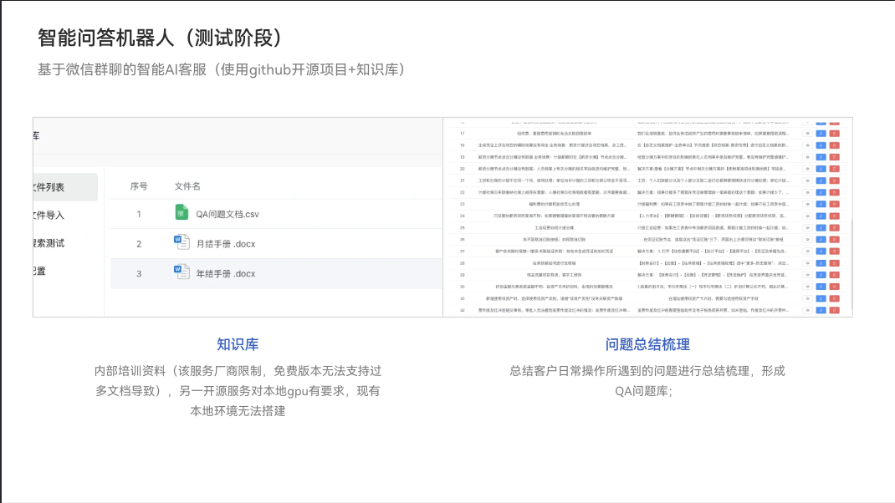
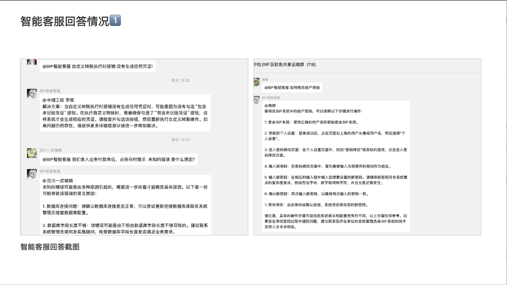

# 王依民 · Yimin Wang

**ERP 实施顾问｜NCCloud 财务信息化｜Oracle / SQL｜业务自动化**

北京 · 从需求调研、系统配置到上线交付与持续运维

[文章与思考](https://github.com/aymanajal/blog) · [联系邮箱](mailto:wym15135582331@outlook.com)

## 关于我

你好，我是王依民，一名 ERP 实施顾问。主要围绕 NCCloud 财务共享、预算、资金、费用报销与电子档案开展实施和运维工作。

- **实施交付**：需求调研与分析、业务方案、系统参数和单据模板配置、UAT 测试、关键用户培训及上线支持。
- **问题定位**：处理审批流堵塞、SQL 逻辑报错和接口异常，使用 Oracle SQL、视图和触发器解决业务问题。
- **流程优化**：结合实际业务改进财务结算与支付复核逻辑，减少重复操作。
- **工具实践**：使用 n8n 搭建自动化流程，探索 AI 辅助逻辑校验与知识库问答。

## 工作经历

| 时间 | 公司与岗位 | 主要工作 |
| --- | --- | --- |
| 2025.05 — 至今 | 如是纵横人力资源（北京）有限公司 · 实施顾问 | 由中电金信定向转入，持续负责中国物流集团财务共享项目；深化实施电子档案、预算、费用与共享模块，处理技术故障及日常运维需求。 |
| 2023.04 — 2025.05 | 中电金信 · 实施顾问 | 财务一体化需求调研、参数与模板配置、开发协同、UAT、培训和上线保障。 |
| 2020.01 — 2023.04 | 北京弗洛格科技有限公司 · 实施顾问 | 参与国投集团财务信息一体化、大连农商银行系统改造；开展需求分析、系统配置与现场验收交付，早期承担网络设备与技术支持工作。 |

## 项目经历

### 1. 中国物流集团财务共享与一键合并报表项目

**当前项目 · 持续实施与运维中**

**项目介绍**

负责千万级财务信息化一体化管控项目的一期实施，涵盖财务共享、资金管理、固定资产、薪酬及费用报销等核心模块的运维与优化，目前仍持续参与项目实施与运维工作。

**主要职责**

1. **系统配置与模板开发**：负责费用报销、财务共享、资金支付、电子档案、预算管理和影像系统的业务参数配置、单据模板设计及打印模板开发。
2. **需求分析与自动化实现**：收集业务部门需求，利用 n8n 工作流搭建自动化处理链路，实现特定业务需求；尝试使用 AI 工具辅助校验后台代码逻辑，提升功能验证效率。
3. **财务结算流程优化**：负责“共享结算自动推司库”等核心功能的逻辑验证与落地，减少人工操作环节，优化财务结算流程。
4. **测试与交付支持**：组织编写测试文档，开展用户验收测试（UAT），支持功能验证与交付。
5. **持续运维与故障处理**：负责上线后的日常运维，处理 SQL 逻辑报错、审批流堵塞及接口调用异常等技术问题。

**自动化与 AI 应用尝试**

围绕项目中的文件处理和业务答疑需求，开展以下实践。

#### n8n：开票申请打印文件批量推送

**业务需求**

在财务共享场景中，需要将开票申请打印 PDF 与对应业务数据关联，再批量推送到指定接口。人工逐一匹配文件、组装数据和上传操作繁琐，也容易出现对应错误，因此使用 n8n 将这一处理过程串联成自动化工作流。

**实现过程**

1. **读取业务数据与文件**：读取 Excel 中的单据号、组织信息等业务字段，同时遍历本地 PDF 目录，提取文件名与路径。
2. **匹配业务与附件**：通过 Merge 节点，以 `fileName` 为匹配字段合并 Excel 数据和 PDF 文件信息。
3. **组装接口报文**：通过 Code 节点整理 PDF 的 Base64 内容，结合业务流水号、单据编号、组织信息和文件列表，生成接口要求的 JSON 报文。
4. **控制批量推送节奏**：使用 Loop Over Items（SplitInBatches）与 Wait 节点逐项处理，配合 HTTP Request 节点执行 POST 请求，避免请求集中发送。
5. **解析回执与结果落地**：提取接口返回的状态码、业务结果、消息、单据号和文件名等信息，汇总后写入 CSV，供推送结果核对与问题追踪。

**实践价值**

将“Excel 匹配 PDF → 报文组装 → 批量推送 → 回执记录”串成可重复执行的流程，减少重复的人工处理，并保留逐条核对的结果日志。

#### 智能客服机器人（测试阶段）

2023.11 — 2023.12，基于开源项目 [chatgpt-on-wechat](https://github.com/zhayujie/chatgpt-on-wechat) 搭建微信群智能问答测试，结合项目常见问题和操作资料，探索业务咨询的自动回复。

整理客户日常操作问题形成 QA 问题库，并尝试接入月结、年结等培训资料。测试中遇到知识库服务免费版对多文档的支持限制；另一开源方案要求本地 GPU，受当时环境限制未完成搭建。

**知识库与问题整理**

**微信群问答测试示例**

测试内容包括报错咨询、账户密码修改和往来核销操作指引。

#### 项目中使用的工具与排障案例

在中国物流集团项目实施与运维过程中使用以下工具，并整理相关排障案例。公开仓库提供代码、使用说明及排查记录。

| 项目 | 说明 |
| --- | --- |
| [YonBIP / NCCloud 顺序审批助手](https://github.com/aymanajal/yonbip-approval-assistant) | Chrome 扩展，支持后台连续执行、固定定位、运行日志与异常提交保护。 |
| [直联支付状态同步扩展](https://github.com/aymanajal/treasury-payment-status-sync-extension) | 针对 YonBIP / NCCloud 直联支付列表的状态同步工具。 |
| [影像后端补丁更新工具](https://github.com/aymanajal/datafly-patch-tool) | 将 JAR 补丁上传、校验、备份、替换、重启和回退整合到网页。 |
| [NMC nPart 运维 Skill](https://github.com/aymanajal/yonyou-nmc-ops-skill) | 用友 NMC nPart 服务启停、重启与状态巡检。 |
| [间歇性 TCP 超时排查案例](https://github.com/aymanajal/gateway-tcp-timeout-case-study) | 脱敏记录双端抓包、旧连接状态复现、空闲回收补丁与后续验证；保留已证实结论和未关闭问题的边界。 |

**AI 辅助需求实现与工作方式的探索**

在持续参与项目的过程中，随着 AI 工具能力的发展，我开始尝试把现场积累的业务理解与 AI 辅助实现结合起来：从收集需求、对接开发，进一步参与程序分析、修改方案和结果验证。

- **影像系统需求修改实践**：向 AI 提供需求说明及已有后端 JAR、前端 ZIP 程序文件，借助 AI 分析程序、定位修改位置，完成前端调整，并获得后端无需修改的判断和数据库补充脚本。从分析到产出可供测试的修改版本，整体不到半小时；这一耗时仅指修改产出，不代表完成测试或上线交付。
- **验证与交付判断**：修改产出后，仍需人工验证业务功能及其他操作是否受到影响。将 AI 分析结论与实际测试结果分开，持续关注方案确认、测试组织和后续维护。
- **实践后的思考**：基于上述尝试，整理[关于 AI 改变 ERP 二次开发和实施分工的文章](https://github.com/aymanajal/blog/blob/main/posts/ai-erp-implementation.md)（[Word 原稿](https://github.com/aymanajal/blog/blob/main/documents/ai-era-business-transformation.docx)），思考现场顾问如何借助业务经验参与更多实现工作，以及开发提速后，需求协作、结果验证与维护责任应如何衔接。

### 2. 国投集团财务信息一体化项目

**项目介绍**

建设财务信息化一体化管控模式，涉及财务共享、资金管理等业务，围绕收支、资产、财务公司及总账共享等场景开展调研、配置、开发协同与上线支持。

**主要职责**

1. **业务调研与方案编写**：参与收支、资产、财务共享前期业务调研，根据调研结果编写业务方案，并收集、梳理审批流程。
2. **共享表单逻辑梳理**：与财务共享关键用户共同梳理收支、资产、财务公司及总账共享表单的逻辑关系。
3. **模板配置与开发协同**：在开发环境中配置模板和审批流程，梳理开发逻辑，并向开发人员讲解业务规则与实现要求。
4. **多字段智能审核**：负责智能审核需求设计与功能上线。针对 NCC 2111 版本仅支持单字段规则判断的限制，结合项目审核规则，通过在开发表单中编写 SQL 实现多字段间的规则判断，并完成通用费用报销单、差旅费用报销单和劳务费报销单的规则配置。
5. **支付结算逻辑优化**：原流程在支付指令发送成功后，仍需业务人员线下复核支付结果并手工确认。优化后，由银企联每 5 秒查询一次指令结果，取得明确结果后自动变更系统指令状态，减少人工复核与确认操作。
6. **个性化需求落地**：收集客户个性化需求，并将其融入开发与实施过程。
7. **功能测试与上线切换**：对开发功能进行测试、反馈问题，形成上线切换报告。
8. **关键用户培训**：编写关键用户操作手册并开展培训。
9. **上线后支持**：持续处理项目上线后的业务与系统问题。

### 3. 大连农商银行财管系统改造

**项目名称：新金融工具准则转换及总账系统建设财管系统改造**

**项目介绍**

根据新金融工具准则，对大连农商银行现有财管系统进行改造，涉及总账、应收应付、固定资产及预算报表编制。

**主要职责**

1. **现场沟通与进度协调**：负责与客户现场沟通协调，把控项目整体进度，保障项目按时上线。
2. **业务模块迁移与调整**：负责总账、预算、固定资产和应收应付模块的迁移、调整与更新，使系统配置符合业务需求。
3. **上线交付文档**：负责用户操作手册、上线切换报告的编写与签字确认，支撑系统切换和用户使用。

## 技能

| 方向 | 实践范围 |
| --- | --- |
| ERP 与财务信息化 | NCCloud、财务共享、预算、资金支付、费用报销、电子档案、影像系统 |
| 数据与排障 | Oracle SQL、视图、触发器、审批逻辑、接口异常定位 |
| 项目交付 | 需求调研、方案与设计文档、系统配置、开发协同、UAT、培训、上线及运维 |
| 自动化与 AI | n8n 工作流、文件与业务数据匹配、接口集成、知识库问答实践 |

## 教育背景

- **山西财经大学** · 本科 · 行政管理（2021.03 — 2024.01）
- **山西轻工职业技术学院** · 专科 · 会计（2017.09 — 2020.07）

## 联系与记录

- 邮箱：[wym15135582331@outlook.com](mailto:wym15135582331@outlook.com)
- 文章：[文章与思考](https://github.com/aymanajal/blog) · [原博客](https://matters.town/@windsdirecti)
- 简历：[完整履历](https://aymanajal.github.io/resume/resume/) · [简历仓库](https://github.com/aymanajal/resume)

---

主页整理于 2026 年 11 月；工作与教育经历依据现有简历。
